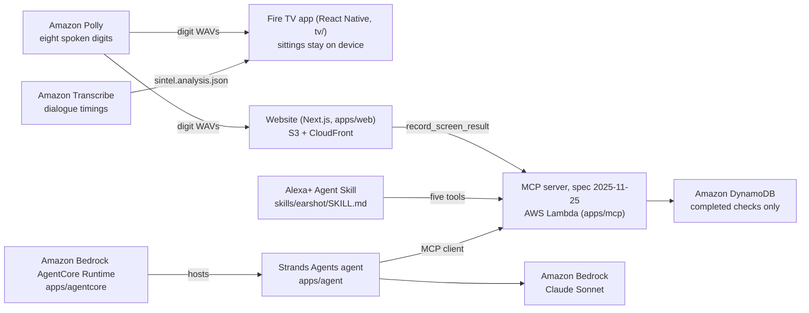

# Earshot

**A Fire TV app that notices when a household listens far past a programme's dialogue, offers a two-minute hearing-in-noise check on the remote, and prepares one page for the doctor.**

- **Live site:** <https://d29nbz7seeunuf.cloudfront.net> (take the check in a browser)
- **Demo video (2:53):** <https://youtu.be/NB-eo4zwwwU>
- **MCP endpoint (Alexa+ surface):** <https://inwrmblw32v4iyzsxkr5bfpidu0izuah.lambda-url.us-east-1.on.aws/mcp>
- **Fire TV APK:** <https://github.com/usv240/earshot/releases/tag/v0.1.2>
- **Open-source library:** [`digits-in-noise`](https://www.npmjs.com/package/digits-in-noise) on npm, source in [`packages/digits-in-noise`](packages/digits-in-noise)

Track: Fire TV. Also entered: Alexa+ (Agent Skill plus a self-hosted MCP server), AWS Builder, Open Source.

## What it does

- **Notices.** The listening model compares how loud a programme's dialogue is with the volume the household chose, and watches for captions going on and for rewinding to hear a line again. No microphone, no camera. Nothing about how you watch leaves the television. ([`packages/earshot-core`](packages/earshot-core), [`tv/src/watch.tsx`](tv/src/watch.tsx))
- **Asks, rarely.** It needs a baseline first, never interrupts a programme, never asks twice in a season, and stops for good after two refusals. ([`packages/earshot-core/src/offer.ts`](packages/earshot-core/src/offer.ts))
- **Measures.** A digits-in-noise check driven by the D-pad: three spoken digits in noise, adaptive, 18 or 24 rounds, ending in a speech reception threshold in dB SNR. The test measures a ratio, not a level, so it works on speakers nobody calibrated. ([`packages/digits-in-noise`](packages/digits-in-noise), [`tv/App.tsx`](tv/App.tsx))
- **Helps.** It explains where Fire TV's Dialogue Boost lives and produces one page to take to a clinician. It is a screen, not a diagnosis, and a test walks every sentence it can say to keep it that way. ([`packages/digits-in-noise/src/report.ts`](packages/digits-in-noise/src/report.ts))
- **Talks to agents.** Five MCP tools over Streamable HTTP, an Agent Skill for Alexa+, and a Strands agent on Amazon Bedrock that answers "why did my TV ask, and has anything changed?" from those tools only. ([`apps/mcp`](apps/mcp), [`skills/earshot/SKILL.md`](skills/earshot/SKILL.md), [`apps/agent`](apps/agent))

## Why it matters

Standard hearing tests play tones in a quiet room. Many people with normal tone results still cannot follow speech in noise, and diagnosing that needs speech measured in noise [1, 2]. Television volume is itself a validated clinical marker: a person who turns the set up has a 68 percent chance of hearing loss of 25 dB or more, at 81 percent sensitivity [3]. Around 80 percent of people with hearing loss do not know, those who notice wait about seven years to ask anyone [4], and the 2024 Lancet standing Commission puts hearing loss among the largest modifiable risk factors for dementia from midlife [5]. The television already has the evidence, every night, on hardware that is already under the set.

## Architecture



The Fire TV app runs alone on the set. The website, the Agent Skill and the Strands agent are all clients of the same MCP server. Polly and Transcribe run once, at build time, to produce the audio and the dialogue analysis the apps ship with ([`apps/pipeline`](apps/pipeline)).

## What is real and what is simulated

- **Real:** the hearing check, the adaptive procedure and the threshold it produces, on the TV and on the web.
- **Real:** the eight digit recordings, synthesised with Amazon Polly (voice Joanna, neural) and levelled to within 0 dB of each other, with masking noise shaped to their own spectrum ([`apps/web/public/audio/digits.json`](apps/web/public/audio/digits.json)).
- **Real:** the dialogue loudness of the film the TV app plays (Sintel), measured through Amazon Transcribe timings ([`apps/pipeline/analysis/sintel.analysis.json`](apps/pipeline/analysis/sintel.analysis.json)), and the sittings the app records while you watch it.
- **Real:** the MCP server, the API keys, the Strands agent run and the AgentCore deployment, all live.
- **Sample data:** the months of viewing history on the TV home screen. The screen says so. A household must watch for months before the model has anything to say, and a third-party app cannot read what other Fire TV apps play ([FRICTION_LOG.md](FRICTION_LOG.md) entry 12).
- **Simulated listeners:** every accuracy figure below comes from running the procedure against a model listener with a known threshold, not from people. See [docs/EVAL.md](docs/EVAL.md).
- **Provisional:** the referral bands. The digits are synthetic speech rather than a normed corpus, so the bands are labelled provisional in the code and in every result.

## Evidence

All figures are read from [`apps/eval/results/validation.json`](apps/eval/results/validation.json), regenerated by `npm run validate`, and pinned by [`apps/eval/test/claims.test.ts`](apps/eval/test/claims.test.ts). CI re-runs the validation and stops if the committed file differs.

| Measurement | Value | Source |
|---|---|---|
| Runs against a reference listener at -9 dB | 2000, none refused | `headline.runs`, `headline.rejected` |
| Bias of the threshold estimate | bias of 0.037 dB | `headline.biasDb` |
| Test-retest spread | test-retest spread 0.748 dB (published range 0.7 to 1.2 dB) | `headline.sdDb`, `comparison` |
| Bias across -14 to -3 dB | under 0.07 dB at every point | `acrossRange` |
| Referral of a listener 2.2 dB inside the normal range | 0.2 percent | `referralCurve` |
| Referral of a listener 1.8 dB outside it | 99.4 percent | `referralCurve` |
| Cut-point | -3.8 dB SNR, from the published diotic categories [6] | `cutPointDb` |
| Dialogue-referenced vs volume-only detection, 200 households | 0 vs 200 false alarms on compensating households; 200 vs 200 detections on creeping ones | `baseline` |

Other committed measurements:

- Digit levelling: 4.37 dB spread before, 0 dB after. Noise matched to the speech spectrum to 1.12 dB mean across 100 Hz to 6 kHz. ([`apps/web/public/audio/digits.json`](apps/web/public/audio/digits.json))
- Sintel: dialogue at -40.6 LUFS over 28.3 s of speech in a 125 s clip; the dialogue gate moved the figure by 0.4 dB on this clip. ([`apps/pipeline/analysis/sintel.analysis.json`](apps/pipeline/analysis/sintel.analysis.json))
- Strands agent, live against the deployed server on 2026-10-19: called `what_the_television_watches`, `explain_the_check` and `get_screen_history`, model `us.anthropic.claude-sonnet-4-6`. ([`apps/agent/runs/hearing-check-in.json`](apps/agent/runs/hearing-check-in.json))
- AgentCore Runtime `earshothearing_hearing`, us-east-1, deployed. ([`apps/agentcore/agentcore/.cli/deployed-state.json`](apps/agentcore/agentcore/.cli/deployed-state.json))

[docs/METHOD.md](docs/METHOD.md) sets the procedure against the literature parameter by parameter. [docs/PRIOR_ART.md](docs/PRIOR_ART.md) names what already exists: Apple's hearing test, Intel's patent on volume-based detection, and what no television does.

## Research

1. ASHA Leader, hidden hearing loss: difficulty with speech in noise despite normal pure-tone thresholds. DOI 10.1044/leader.FMP.23032018.6. <https://leader.pubs.asha.org/doi/10.1044/leader.FMP.23032018.6>
2. 2025 systematic review: diagnosis needs speech-in-noise measurement rather than pure-tone audiometry alone. PMC11940875. <https://www.ncbi.nlm.nih.gov/pmc/articles/PMC11940875/>
3. *Validation of self-reported hearing loss using television volume*, Journal of Laryngology and Otology. PMID 20831845. <https://pubmed.ncbi.nlm.nih.gov/20831845/>
4. ASHA, *Untreated Hearing Loss in Adults*. <https://www.asha.org/Articles/Untreated-Hearing-Loss-in-Adults/>
5. Livingston et al., Lancet standing Commission on dementia, 2024. <https://www.thelancet.com/article/S0140-6736(24)01296-0/abstract>
6. *Discrimination of degrees of auditory performance from the digits-in-noise test based on hearing status*, International Journal of Audiology. DOI 10.1080/14992027.2020.1787531. <https://www.tandfonline.com/doi/full/10.1080/14992027.2020.1787531>
7. *The digits-in-noise test: Assessing auditory speech recognition abilities in noise*, J. Acoust. Soc. Am. <https://pubs.aip.org/asa/jasa/article/133/3/1693/913552/The-digits-in-noise-test-Assessing-auditory-speech>
8. *The one-up one-down adaptive (staircase) procedure in speech-in-noise testing*, J. Acoust. Soc. Am. <https://pubs.aip.org/asa/jasa/article/152/4/2357/2839490/The-one-up-one-down-adaptive-staircase-procedure>
9. *Evaluating a smartphone digits-in-noise test as part of the audiometric test battery*. PMC5968873. <https://www.ncbi.nlm.nih.gov/pmc/articles/PMC5968873/>
10. *The Feasibility and Reliability of a Digits-in-Noise Test in the Clinical Follow-Up of Children*. PMC8221724. <https://pmc.ncbi.nlm.nih.gov/articles/PMC8221724/>
11. *Digits-In-Noise Hearing Test Using Text-to-Speech and Automatic Speech Recognition*. PMC12489207. <https://pmc.ncbi.nlm.nih.gov/articles/PMC12489207/>
12. *Remote self-report and speech-in-noise measures predict clinical audiometric thresholds*. PMC12951638. <https://pmc.ncbi.nlm.nih.gov/articles/PMC12951638/>
13. *The multilingual digits-in-noise (DIN) test: development and evaluation*, International Journal of Audiology. DOI 10.1080/14992027.2024.2397068. <https://www.tandfonline.com/doi/full/10.1080/14992027.2024.2397068>
14. FDA, first over-the-counter hearing aid software authorised, September 2024. <https://www.fda.gov/news-events/press-announcements/fda-authorizes-first-over-counter-hearing-aid-software>
15. NIDCD, *Quick Statistics About Hearing*. <https://www.nidcd.nih.gov/health/statistics/quick-statistics-hearing>

## Run it

Node 20 or newer. No AWS account is needed for any of this.

```
npm install          # also installs the Fire TV app under tv/
npm test             # the whole suite, both runners
npm run validate     # regenerate apps/eval/results/validation.json
npm run web:dev      # the site, with the check you can take yourself
npm run mcp          # the MCP server locally (in-memory store)
```

**Fire TV.** Install the release APK on a device or emulator with ADB debugging on ([tv/README.md](tv/README.md) has the build steps):

```
adb connect <your Fire TV ip>:5555
adb install earshot-tv-v0.1.2.apk
```

**Agent.** The Strands agent needs AWS credentials with Bedrock access:

```
pip install strands-agents mcp
python apps/agent/hearing_check_in.py --household ours
```

**Your own MCP space.** The server is open by default. For a private space, take a free key and send it as `Authorization: Bearer <key>` on every request to `/mcp`:

```
curl -X POST https://inwrmblw32v4iyzsxkr5bfpidu0izuah.lambda-url.us-east-1.on.aws/v1/keys
```

**Deploy.** `npm run deploy` builds the site and deploys the CDK stack in [`infra/bin/app.ts`](infra/bin/app.ts). The AgentCore runtime deploys from [`apps/agentcore`](apps/agentcore) with `npx @aws/agentcore deploy --yes`. [docs/AWS.md](docs/AWS.md) lists the permissions.

## Tests

225 tests across two runners, all passing:

```
npx vitest run        # 19 files, 204 tests: packages, pipeline, MCP server, eval
npm --prefix tv test  # 3 suites, 21 tests: the Fire TV app under jest
npm test              # runs both
```

What the suite checks, beyond the code: every published accuracy figure is re-derived from the committed run; the test count, the friction-log count and the MCP tool list in the skill are counted rather than typed; no document may claim a first or claim validation on people; every sentence the product can say is walked for diagnoses or promises; and no MCP tool may ever return a listening figure.

## AWS and tools used

| Tool | What it does here | Where |
|---|---|---|
| Fire TV (Fire OS) | React Native TV app, driven by the D-pad; reads system volume through a native module | [`tv/`](tv), [`tv/android/app/src/main/java/com/earshottv/SystemVolumeModule.kt`](tv/android/app/src/main/java/com/earshottv/SystemVolumeModule.kt) |
| Alexa+ (Agent Skill) | the skill that tells an agent how to use the five tools; a test checks it names each one | [`skills/earshot/SKILL.md`](skills/earshot/SKILL.md) |
| MCP, spec 2025-11-25, Streamable HTTP | the server: five tools, signed sessions, Origin handling, API keys | [`apps/mcp/src/mcp.ts`](apps/mcp/src/mcp.ts), [`apps/mcp/src/keys.ts`](apps/mcp/src/keys.ts) |
| Strands Agents | the Hearing Check-in agent, an MCP client with no other data access | [`apps/agent/hearing_check_in.py`](apps/agent/hearing_check_in.py) |
| Amazon Bedrock | Claude (`us.anthropic.claude-sonnet-4-6`) behind the agent | [`apps/agent/hearing_check_in.py`](apps/agent/hearing_check_in.py) |
| Amazon Bedrock AgentCore | hosts the same agent as an invocable runtime | [`apps/agentcore/app/hearing/main.py`](apps/agentcore/app/hearing/main.py) |
| Amazon Polly | the eight spoken digits, as raw PCM | [`apps/pipeline/src/digits.ts`](apps/pipeline/src/digits.ts) |
| Amazon Transcribe | word timings to locate dialogue; the words are never used | [`apps/pipeline/src/speech.ts`](apps/pipeline/src/speech.ts), [`apps/pipeline/src/analyse.ts`](apps/pipeline/src/analyse.ts) |
| AWS Lambda, Amazon DynamoDB, Amazon S3, Amazon CloudFront, AWS CDK | the MCP server, the results store, the site, one deploy | [`infra/bin/app.ts`](infra/bin/app.ts) |

Product feedback on each tool is in [PRODUCT_FEEDBACK.md](PRODUCT_FEEDBACK.md). The friction log is [FRICTION_LOG.md](FRICTION_LOG.md).

## Privacy

- **On the television:** sittings (level, duration, captions, rewinds) are kept in `react-native-mmkv` on the device, capped at 400 rows, and never uploaded. There is no server-side store for them anywhere in the project. ([`tv/src/store.ts`](tv/src/store.ts))
- **On the server:** a completed check is one append-only row: household name, date, threshold, whether the run was usable, its band, its reference, which surface took it, and whether the audio was placeholder. No audio, no answers, no identity. ([`apps/mcp/src/store.ts`](apps/mcp/src/store.ts))
- **API keys:** nothing about a key is stored. The space it reaches is a prefix of its hash, computed on each request. ([`apps/mcp/src/keys.ts`](apps/mcp/src/keys.ts))
- **Transcribe:** the only audio sent to AWS is the film's own soundtrack, once, at build time. Only `start_time` and `end_time` are read from the result. ([docs/AWS.md](docs/AWS.md))
- **No microphone and no camera** anywhere in the app, the site or the server.

## Licence

MIT, see [LICENSE](LICENSE). `digits-in-noise` is published separately under MIT at <https://www.npmjs.com/package/digits-in-noise>.
